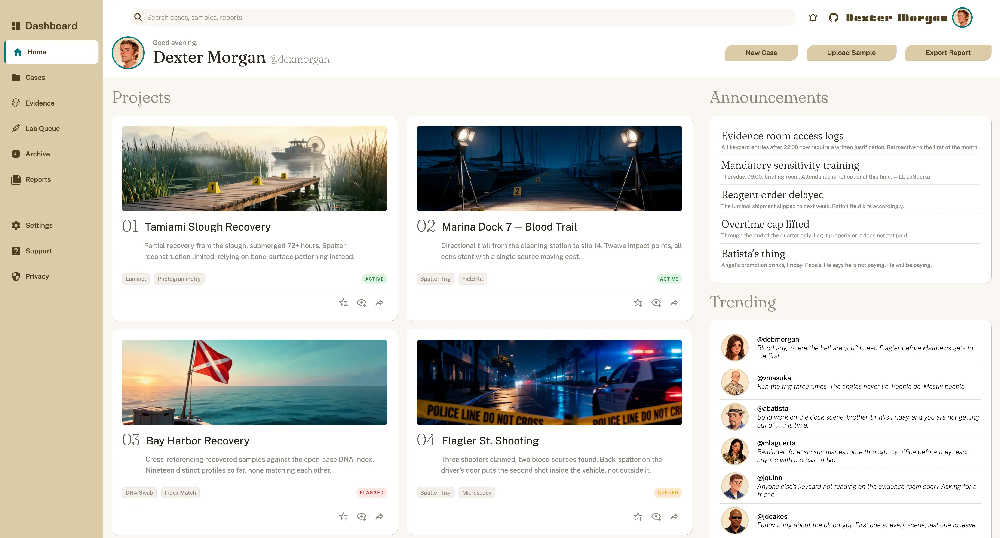

# TOP-Admin-Dashboard

# Miami Metro Forensics

A responsive admin dashboard built with CSS Grid, created for The Odin
Project's Intermediate HTML and CSS course.

Rather than filling it with placeholder text, the dashboard is dressed as a
case management tool for a forensics analyst — real content of varying
length, which turned out to be the better test. Two-line titles, clamped
descriptions and a six-row sidebar surface layout problems that lorem ipsum
never does.

## Live demo

https://knshnbz.github.io/TOP-Admin-Dashboard/

## What this project practises

- **CSS Grid** for the page shell, the card grid and the internals of each
  card — three nested grids with different intents
- **Cascade layers** (`@layer`) to keep reset, layout and visual design from
  fighting each other
- **Custom properties** as a two-tier system: raw tokens at `:root`,
  semantic names (`--clr-ink`, `--clr-line`, `--clr-surface`) in use
- **OKLCH colour** so the whole neutral ramp sits on one hue and stays
  perceptually even across lightness steps
- **Native CSS nesting** and `:has()` for the search field's focus state
- **Layered box shadows** for elevation instead of a single flat shadow
- `line-clamp` and `minmax()` for content that refuses to stay tidy

## Build notes

**One hue for everything.** The sand theme sits at hue 77. An early version
paired it with blue-grey neutrals at hue 230, and the page never settled.
Pulling every neutral to hue 75–80 at very low chroma fixed it in one pass —
the greys stopped competing with the theme and started belonging to it.

**Two border tokens, not one.** Structural edges (sidebar, header) and
dividers inside a card are different jobs and need different weights.

## Credits

- Icons — [Material Design Icons](https://pictogrammers.com/library/mdi/)
- Typefaces — [Fraunces](https://fonts.google.com/specimen/Fraunces),
  [Public Sans](https://fonts.google.com/specimen/Public+Sans) and
  [Plaster](https://fonts.google.com/specimen/Plaster) via Google Fonts
- Avatars and scene images generated with AI tools, then resized and
  converted to WebP

Characters and setting are from the television series *Dexter*, used here as
placeholder content for a student exercise.